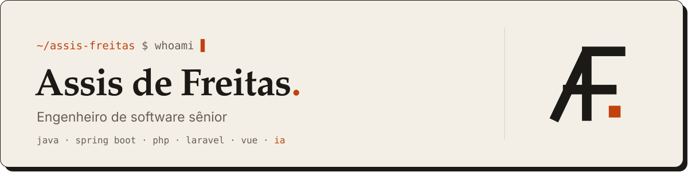

<picture>
  <source media="(prefers-color-scheme: dark)" srcset="assets/banner-dark.svg">
  
</picture>

<p>
  <a href="https://assisfreitas.dev"></a>
  <a href="https://www.linkedin.com/in/francisco-freitas/"></a>
</p>

```yaml
assis:
  papel: Engenheiro de software sênior
  experiencia: 10+ anos, sistemas de missão crítica
  stack: [Java, Spring Boot, PHP, Laravel, Vue, Angular]
  projetos_pessoais: produtos com IA (Spring AI, LLMs)
  site: https://assisfreitas.dev   # também em inglês e espanhol
```

### Stack

<p>
  
</p>

### Projetos pessoais

<p>
  <picture>
    <source media="(prefers-color-scheme: dark)" srcset="assets/card-chico-ai-dark.svg">
    
  </picture>
  <picture>
    <source media="(prefers-color-scheme: dark)" srcset="assets/card-ia-learn-dark.svg">
    
  </picture>
  <picture>
    <source media="(prefers-color-scheme: dark)" srcset="assets/card-token-converter-dark.svg">
    
  </picture>
</p>

### Projetos abertos

<!-- Adicione aqui os projetos de vitrine conforme forem ficando prontos. -->

| Projeto | O que é |
|---|---|
| [**assisfreitas.dev**](https://github.com/assis-freitas/assisfreitas.dev) | Meu site pessoal, em português, inglês e espanhol. Feito com Astro e servido por nginx em Docker. |

<br>

<sub>Banner e cards gerados por <code>scripts/gen_assets.py</code>. Projetos e opiniões aqui são pessoais e não representam meus empregadores.</sub>
