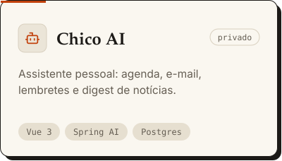
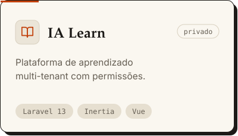
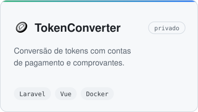

<picture>
  <source media="(prefers-color-scheme: dark)" srcset="assets/banner-dark.svg">
  
</picture>

<br>

```yaml
assis:
  papel: Dev full-stack
  stack: [Laravel, Vue 3, Spring Boot, PostgreSQL]
  agora: produtos com IA (Spring AI, LLMs)
  papo: [arquitetura web, Laravel, Spring, LLMs]
```

### 🧰 Stack

<p>
  
</p>

### 🔨 No que estou trabalhando

<p>
  <picture>
    <source media="(prefers-color-scheme: dark)" srcset="assets/card-chico-ai-dark.svg">
    
  </picture>
  <picture>
    <source media="(prefers-color-scheme: dark)" srcset="assets/card-ia-learn-dark.svg">
    
  </picture>
  <picture>
    <source media="(prefers-color-scheme: dark)" srcset="assets/card-token-converter-dark.svg">
    
  </picture>
</p>

### 🚀 Projetos abertos

<!-- Adicione aqui os projetos de vitrine conforme forem ficando prontos. -->

> Em breve: projetos pequenos, completos e com demo no ar.

<br>

<sub>Projetos antigos (2015–2021) estão arquivados.</sub>
